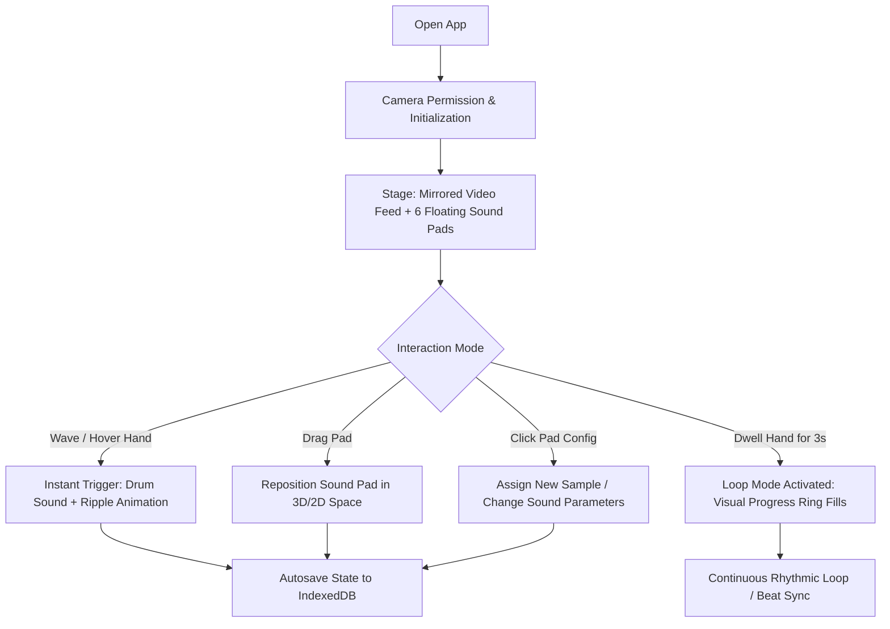

# Alpha Specification Document: Gestrum
**Author:** Keegan McConnell  
**Version:** Alpha Spec v0.1.0  
**Target Format:** Single-File HTML5 Progressive Web App (PWA)  
**Deployment Target:** GitHub Pages (`https://keeganrmc.github.io/gestrum/`)  
**Architecture Guidelines:** Conforming to `Single_File_HTML_App_Template.TXT`

---

## 1. Executive Summary & Vision

**Gestrum** is a touchless, spatial browser-based musical instrument. By leveraging the user's webcam and real-time computer vision, Gestrum translates physical hand gestures in mid-air into expressive percussion and looped soundscapes.

Users interact with six floating spatial sound circles ("sound pads") mapped to drum kit elements or melodic samples. Holding a gesture over a pad for three seconds locks it into an automated rhythmic loop. Sound pads can be physically dragged and repositioned across the spatial canvas, allowing performers to sculpt a custom physical drum kit layout tailored to their reach and camera framing.

The application operates **entirely client-side** with zero backend infrastructure, ensuring total privacy (video streams never leave the user's device), instant offline capability, and frictionless deployment via GitHub Pages.

---

## 2. Seed & Raison d'Être

* **Core Seed:** An intuitive, embodied air-percussion instrument that feels like playing a futuristic invisible drum set, turning any laptop or tablet webcam into an instant music station.
* **Medium:** Motion, Sound (Percussion & Synthesis), Spatial UI, Visual Feedback.
* **Why Gestrum Exists:** Traditional virtual instruments demand mechanical key presses or touchscreen tapping, which feels rigid and unexpressive. Existing webcam music experiments are often academic, fragile, or hard to calibrate. Gestrum exists because making music in the air should be playful, immediate, visual, and require zero setup or hardware beyond a standard web browser.
* **The ONE Thing It Must Do Better Than Anything Else:** **Immediate, low-latency spatial response** with clear visual feedback so the player immediately feels the tactile "snap" of hitting a drum in mid-air.
* **Deliberate Non-Goals (Scope Boundaries):**
  * *No complex multi-track DAW sequencing:* Gestrum is an expressive performance instrument and looper, not Ableton Live.
  * *No remote cloud storage or account logins:* All custom kits, loop states, and settings persist locally in IndexedDB.
  * *No external server-side video processing:* Hand detection and audio synthesis run 100% locally on the device CPU/GPU.

---

## 3. User Persona & Context

* **Primary User:** A student, creative coder, or bedroom musician (like a 2nd-year design/music tech student) sitting or standing in front of a laptop or tablet, wanting to jam out a beat, build a fast rhythmic groove, or physically perform in 5 to 15 minute sessions.
* **Physical & Environmental Setting:** Indoor room, laptop webcam at arm's length (roughly 1.5 to 3 feet away), ambient room lighting.
* **Secondary Audience:** Spectators and peers watching a live performance, screen recording, or interactive portfolio demonstration.
* **Who It Is NOT For:** Studio audio engineers looking for microsecond MIDI quantizing or complex multi-mic acoustic kit emulation.

---

## 4. Core Interaction Model & Flow



### 4.1 First 10 Seconds
When the application opens, the user sees:
1. A unified, dark cyber-minimalist stage (`#0d0f12`) with subtle reactive grid elements. **No raw webcam video feed is shown**; the webcam runs silently in background memory, and the player's hands are rendered as floating **Luminous Orbs** that track fingertip coordinates with fluid particle motion trails.
2. Six translucent glowing sound circles arranged in a clean **two-row by three-column beat-grid (3x2)**.
3. A ready-to-play default kit with active audio synthesis. If camera access is pending or unavailable, an intuitive pointer fallback lets the user click or touch pads immediately.

### 4.2 Core Interaction Loop
* **Hover / Strike Trigger:** Move a hand over a circle. As the hand centroid or fingertip enters the pad boundary, the assigned sound fires instantly with a radial ripple and glow shockwave.
* **Dwell to Loop (3-Second Hold):** When a hand hovers continuously over a pad for 3 seconds, a circular progress stroke fills around the pad. Upon completion, the sound latches into active looping mode synchronized to a master BPM clock.
* **Spatial Repositioning (Sound Blocks):** Pads can be clicked/dragged (or pinched in air) to relocate them anywhere on the stage, adapting to different player heights, chair setups, or arm reaches.
* **Sound Assignment & Sound Kits:** Users can select any pad to swap its sound:
  * Default synthesized 808 / acoustic percussion kit (zero external file dependencies).
  * Preset alternatives (Sci-fi synths, glitch percussion, tonal bells).
  * Custom audio file drag-and-drop (WAV, MP3) saved to IndexedDB.

### 4.3 Fallback & Accessibility Principle
Per the template's guidelines, keyboard/mouse/touch controls must achieve parity with gesture controls. Hovering with a mouse or touching pads triggers identical audio and loop-dwell behaviors.

---

## 5. Technical Architecture

Gestrum complies strictly with the **Single-File HTML App** standard:

```
airdrummer/
├── index.html            # Core app (HTML + CSS + JS in one file)
├── manifest.webmanifest  # PWA installation metadata
├── sw.js                 # Service worker: offline cache & updates
├── icon.svg              # Vector logo / favicon
├── icon-192.png          # PWA icon
├── icon-512.png          # PWA high-res icon
├── og.png                # Social share preview (1200x630)
├── BRIEF.md              # Project north star & interview record
├── ALPHA_SPEC.md         # Technical alpha specification (this doc)
├── HANDOFF.md            # Session tracking & maintenance log
├── README.md             # Human-facing GitHub repository documentation
└── CHANGELOG.md          # Chronological release log
```

### 5.1 Subsystems

1. **Computer Vision & Hand Tracking Engine:**
   * Uses HTML5 `navigator.mediaDevices.getUserMedia({ video: { facingMode: 'user' } })`.
   * **Tracking Framework:** MediaPipe Hands (vendored locally for offline PWA compliance) extracting 21 3D landmarks $(x, y, z)$ per hand at up to 60 FPS.
   * **Fingertip Collision Detection:** Primary strike points tracked at Landmark 8 (Index fingertip) and Landmark 12 (Middle fingertip).
   * **Velocity & Power Calculation:** Strike velocity is measured on entry into a pad zone by computing the downward speed vector:
     $$v = \frac{\Delta y}{\Delta t} + \alpha \frac{\Delta z}{\Delta t}$$
     where $\Delta y$ captures downward strike acceleration and $\Delta z$ measures forward punch toward the camera. Values normalize to a velocity multiplier between 0.2 (gentle tap) and 1.0 (hard air strike).
   * **Tracking Smoothing & Debounce:** Exponential moving average filters noise; a 120ms re-trigger debounce prevents accidental double-triggering while hands linger.
   * **Dwell Detection:** Tracks continuous presence within pad radius $R$; if the fingertip remains inside for 3.0 continuous seconds, loop mode engages.

2. **Web Audio Synthesis & Playback Engine:**
   * Built entirely using the native browser `AudioContext`.
   * **Velocity-Responsive Dynamics:** Strike velocity dynamically modulates both Web Audio `GainNode.gain` (volume) and `BiquadFilterNode.frequency` (timbral brightness/punch—harder strikes produce richer harmonic crack).
   * **Synthesized Drum Algorithms:**
     * *Kick:* Sine oscillator sweeping rapidly from 150 Hz down to 35 Hz with exponential gain decay, punched up on high velocity.
     * *Snare:* White noise buffer through a bandpass filter layered over an 180 Hz decaying body oscillator.
     * *Hi-Hats:* High-pass filtered noise with sharp 0.05s / 0.3s exponential decay envelopes.
     * *Toms:* Pitched sine waves with resonant frequency envelope modulation.
   * **Loop Engine:** High-precision Web Audio clock scheduling (`AudioContext.currentTime`) keeping all looped pads locked to a master tempo grid (e.g. 120 BPM).

3. **State, Undo, & Autosave Pipeline:**
   * Single root document state object (`doc`) defining pad positions, assigned sound types, loop states, volume, and BPM.
   * Debounced persistence to **IndexedDB** (400ms debounce), surviving reloads and browser crashes.
   * Linear Undo/Redo history stack (Cmd+Z / Ctrl+Z + on-screen buttons).

4. **Export Capabilities:**
   * **Project Export/Import:** JSON project file (`airdrummer-<timestamp>.airdrummer`).
   * **Audio Performance Export:** Record live sessions using `MediaStreamDestination` + `MediaRecorder` into downloadable `.webm` / `.wav` audio clips.

---

## 6. Prior Art & Competitive Landscape

| Precedent / Project | Author / Type | Year | Notable Strength | Gestrum Differentiation |
| :--- | :--- | :--- | :--- | :--- |
| **Sonari** | Research / Creative Coding | 2022 | Spatial sound-field mapping | Gestrum is zero-setup, PWA-installable, and features distinct physical drum kit ergonomics. |
| **Gesture.live** | Indie / Open-Access Web App | 2021 | Browser webcam body tracking | Requires heavy internet bandwidth; Gestrum works completely offline and runs lightweight synthesis. |
| **Gesture Synth** | Open Source | 2020 | Continuous synth pitch modulation | Gestrum focuses on discrete percussion strikes and a 3-second hold-to-loop workflow. |
| **Handmate** | Academic Research | 2023 | Detailed finger pose analysis | Handmate is research-focused; Gestrum focuses on instant performance joy and tactile visual feedback. |

---

## 7. Visual Identity & Atmosphere

* **Aesthetic Register:** Cyber-acoustic stage; neon-glow instruments floating against a darkened, subtle camera canvas.
* **Palette:**
  * Background: Deep Void (`#0d0f12`)
  * Primary Accent / Pad Glow: Electric Cyan (`#00f0ff`)
  * Strike Flash: Hot Magenta / Neon Pink (`#ff007f`)
  * Looping State: Radiant Gold (`#ffd700`)
  * Text / Indicators: High contrast crisp white / muted slate (`#f0f4f8` / `#8a99a8`)
* **Interface Voice:** Kinetic, playful, concise ("Strike", "Looping", "Saved", "Hold to loop").

---

## 8. Alpha Development Phases

* **Phase 0: Repository & Deployment Foundation**
  * GitHub repo initialization, GitHub Pages configuration, basic CI/CD automated push setup.
* **Phase 1: Walking Skeleton (`v00000-001`)**
  * Single `index.html` with camera video feed, 6 static circles, click-to-sound Web Audio kick/snare, version chip, PWA manifest and service worker. Deployed live on GitHub Pages.
* **Phase 2: Spatial Motion Tracking & Gesture Triggers (`v00000-002`)**
  * Integrate real-time webcam motion tracking; trigger drum hits on hand entry with collision debounce.
* **Phase 3: Looping & Sound Block Manipulation (`v00000-003`)**
  * Implement 3-second dwell countdown ring; loop sequencing; draggable pad repositioning; IndexedDB autosave.
* **Phase 4: Sound Kits & Customization (`v00000-004`)**
  * Full synthesized kit + custom sample drop; Help ring-light system; About panel; performance audio recording export.
* **Phase 5: User Testing & Review Loop (`v00000-005`)**
  * Usability testing with real musicians; markup review iterations; latency tuning.
* **Phase 6: V1 Polished Release**
  * Final PWA audit, social preview cards, portfolio card integration.
